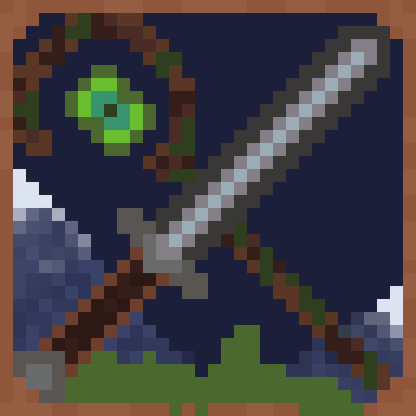

# Classes and Magie — Wiki

[🇫🇷 Français](Home.md) · 🇬🇧 English

**Classes and Magie** is a role-playing plugin for **Paper 26.x** (Java 25): classes, subclasses, skills and mana, races, traits, skill tree, attributes, jobs with specializations, forge with rarities, gems to cut and socket, parties, quests, HUD.

> This wiki is generated automatically from the `docs/wiki` folder of the repository. Corrections and additions can be proposed by pull request on that folder.
>
> The default content (names, menus, messages) and the commands are in French, with English aliases for the main commands. Every text can be translated in `messages.yml`.

## A player's journey

1. **Class** (`/classe`): Warrior, Mage, Archer, Assassin, Cleric → starter kit.
2. **Race** (`/race`): bonuses, weaknesses, and penalties when the race does not suit the class.
3. **Traits** (`/traits`): 3 randomly rolled traits, limited rerolls, unique traits.
4. **Weaknesses** (`/faiblesses`): imposed by the race or class, or rolled randomly depending on them.
5. **Job** (`/metier`): a single job, which unlocks actions and recipes by level.
6. Progression: class levels, **subclass**, **skill tree** (`/arbre`), **attributes** (`/stats`), job **specialization** at level 20.
7. **Quests** (`/quetes`), all optional: tutorial offered at the end of creation, main story, class quests, side and secret quests.

Creation steps cannot be skipped by closing the menu (it opens again), and rolled traits and weaknesses still have to be confirmed after a disconnect. Closing the job menu means "choose later". A player who dies during creation gets the current step back on respawn. Can be disabled with `force-class-selection: false`.

During creation, the player is **protected**: no damage taken, ignored by monsters, and unable to attack (`creation-protection: false` to disable).

## Pages

| Page | Content |
|---|---|
| [Installation](EN-Installation.md) | Requirements, compatible plugins, configuration files, modules |
| [Classes](EN-Classes.md) | Classes, subclasses, stats, weaknesses, conditions |
| [Skills and mana](EN-Skills-and-mana.md) | Skill hotbar, mana, skill types, MythicMobs |
| [Levels and XP](EN-Levels-and-XP.md) | XP curve, XP per monster |
| [Races and traits](EN-Races-and-traits.md) | Races, class penalties, traits and unique traits |
| [Weaknesses](EN-Weaknesses.md) | Every weakness: imposed, random, conditions |
| [Progression](EN-Progression.md) | Skill tree and attributes |
| [Quests](EN-Quests.md) | Tutorial, story, class, side and secret quests, journal, quest tracker |
| [Jobs](EN-Jobs.md) | Jobs, restrictions, levels, recipes, specializations |
| [Forge](EN-Forge.md) | Rarities, random stats, unique items |
| [Gems and jewelcrafting](EN-Gems-and-jewelcrafting.md) | Raw gems, cutting, rarity, purity, socketing |
| [Items](EN-Items.md) | Starter kits, item restrictions, custom items |
| [Parties and chat](EN-Parties-and-chat.md) | Parties, rules, party chat |
| [HUD](EN-HUD.md) | Floating damage, target health, XP |
| [Commands](EN-Commands.md) | Commands, permissions, placeholders, API |
| [Limits](EN-Limits.md) | What the plugin does not do |

## Stat calculation order

A player's final stats are added or multiplied in this order:

`class (+ subclass) → race → race/class penalty → traits → weaknesses → job → specialization → attributes → skill tree → forged equipment and gems`

"Additive" values (health, mana, armor…) are added; multipliers (damage, damage taken) are multiplied.
